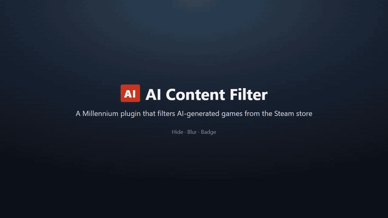
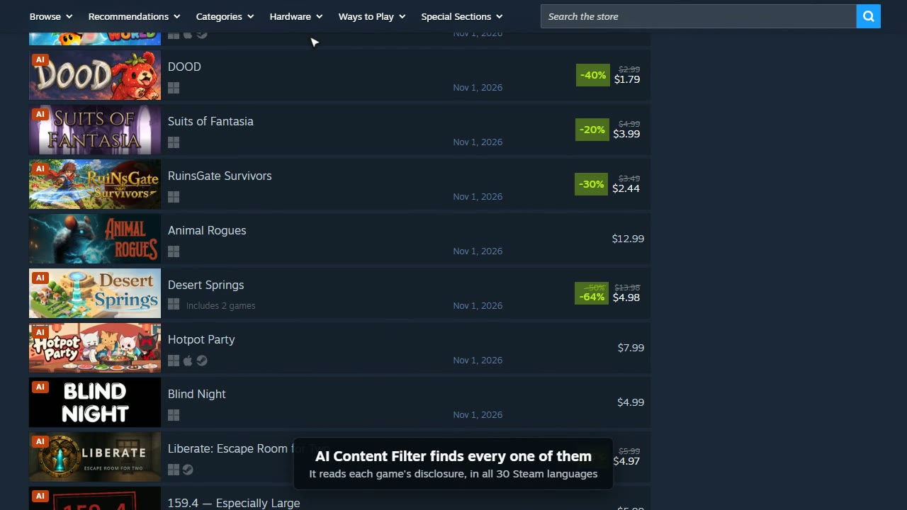
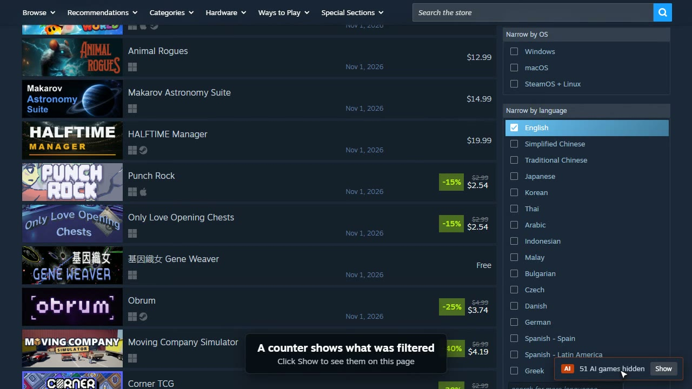
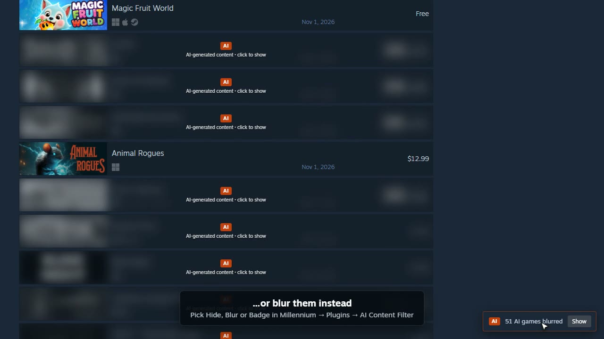
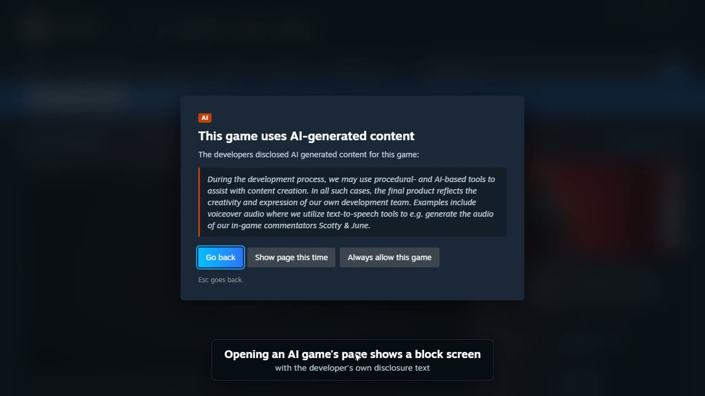

<div align="center">


<h1>AI Content Filter</h1>

<b>Keep games with an AI Generated Content Disclosure out of your Steam store.</b>

<br><br>

<a href="LICENSE"></a>
<a href="https://github.com/EY4O/Steam-AI-Content-Filter/commits"></a>
<a href="https://ko-fi.com/looneth"></a>

</div>

AI Content Filter is a [Millennium](https://steambrew.app) plugin for the Steam desktop client. It reads the **AI Generated Content Disclosure** that developers put on their store pages, and hides, blurs or labels those games everywhere you browse the store: search results, the front page and its carousels, your wishlist and the discovery queue. Opening an AI game's own page shows a block screen with the developer's disclosure, so you decide whether to continue.

<div align="center">

<br><sub><a href="docs/demo.mp4">Watch the demo as MP4</a></sub>
</div>

> **⚠ Requires Millennium.** Install [Millennium](https://steambrew.app) for Steam first. The plugin was built and tested with Millennium 3.6 on Windows.

## ✨ Key Features

- 🙈 **Three ways to filter** — hide AI games completely, blur them behind a click-to-show veil, or just mark them with an **AI** badge.
- 🛑 **Block screen on game pages** — an AI game's store page opens behind a notice quoting the developer's own disclosure, with **Go back**, **Show page this time** and **Always allow this game**.
- 🗂️ **Works across the store** — search and browse lists, the front page and carousels, your wishlist and the discovery queue.
- ✅ **Per-game allowlist** — allow the games you are fine with; manage the list in the plugin settings or straight from the game's page.
- 🔢 **Hidden-games counter** — a small chip shows how many games were filtered on the page, with **Show** to reveal them for a moment.
- 🌍 **All 30 Steam languages** — detection matches the disclosure heading in every language the store supports, not just English.
- ⚡ **Light on the network** — only games that scroll into view are checked, results are cached for 7 days (adjustable), and each check stops reading once the disclosure section has passed.
- ⌨️ **Keyboard friendly** — the block screen traps focus and **Esc** goes back; blurred games open with **Enter** or **Space**.

## 📸 Screenshots

| | |
|:---:|:---:|
| <br>**Badge** — AI games stay in the list with an AI label. | <br>**Hide** — AI games disappear; the chip counts them. |
| <br>**Blur** — AI games are blurred until you click one. | <br>**Block screen** — an AI game's page shows the disclosure first. |

<sub>Screenshots are frames from the demo, recorded on the live Steam store (search sorted by newest releases).</sub>

## 📦 Installation

### Option 1: **Build and install from source** (Recommended)

You need [Node.js](https://nodejs.org) 18 or newer and Steam with Millennium installed.

```bash
git clone https://github.com/EY4O/Steam-AI-Content-Filter.git
cd Steam-AI-Content-Filter
npm install
```

Open `millennium.toml`, set `output_path = "auto"` under `[compiler]`, then build:

```bash
npx starlight pack --release
```

`auto` writes the plugin straight into Millennium's plugins folder. Restart Steam, then turn the plugin on in **Millennium → Plugins**.

### Option 2: **Manual Installation**

Build with the default `output_path = "dist"`; the packed plugin is written to a file named `dist` in the project folder.

```bash
npx starlight pack --release
```

Copy that file into Millennium's plugins folder as `ai-content-filter.star`:

```powershell
Copy-Item dist "C:\Program Files (x86)\Steam\millennium\plugins\ai-content-filter.star"
```

<sub>Adjust the path if Steam is installed somewhere else.</sub>

Restart Steam and turn the plugin on in **Millennium → Plugins**.

## 🚀 Getting Started

1. Turn on **AI Content Filter** in **Millennium → Plugins** and restart Steam when asked.
2. Open the Steam store and browse, for example **New & Noteworthy** or a search sorted by release date. AI games are hidden as they scroll into view.
3. Open **Millennium → Plugins → AI Content Filter** to pick **Hide**, **Blur** or **Badge only**. The store updates within a few seconds; no restart needed.
4. Click **Show** on the counter in the bottom-right corner to see what was filtered on the current page.
5. On a game's page, use **Always allow this game** for games you want to see. Remove them later from the allowlist in the settings, or with **Remove from allowlist** on the game's page.

## 📖 How It Works

<details>
<summary><b>🔍 Detection</b></summary>

Steam shows the disclosure in the **Content Descriptors** box of a game's store page (`#game_area_content_descriptors`), under a heading such as *AI Generated Content Disclosure*. The plugin reads the headings in that box and matches them against the disclosure title in all 30 store languages. Mature-content headings, which share the same box, are excluded, so a game that only has a mature content notice is not flagged.

Any disclosure counts, whatever the developer wrote about how AI was used. The block screen and banner quote the developer's text so you can judge for yourself, and the allowlist covers the games you decide to keep.

</details>

<details>
<summary><b>⚡ Checks and caching</b></summary>

- Store lists don't say whether a game has a disclosure, so the plugin fetches the game's store page in the background, with your normal store session, the same way your browser would.
- Only entries within about one screen of the visible area are checked. At most three checks run at a time; if Steam answers *Too Many Requests*, checks pause for 30 seconds.
- Each check stops reading the page once it reaches the system requirements section, which comes after the content descriptors. That saves roughly 40% of the download.
- Results are stored in the store's local storage for 7 days by default (1–30 in settings). Games that couldn't be checked (region-locked, removed) are retried after 6 hours. **Clear cache** in settings starts over.

</details>

<details>
<summary><b>🔞 Age-gated games</b></summary>

When a game's page is behind Steam's age check, the plugin asks its Lua backend to fetch the page with the usual age-check cookies attached to that single request. Nothing is changed in your Steam account or browser cookies.

</details>

<details>
<summary><b>🧩 What runs where</b></summary>

| Part | Runs in | Does |
|---|---|---|
| `webview/` | Steam's store pages | Scans lists, checks games, draws the badges, blur, chip, banner and block screen. |
| `frontend/` | Steam's main UI | The settings panel under **Millennium → Plugins**. |
| `backend/` | Millennium's Lua runtime | Stores settings and the allowlist, and fetches age-gated pages. |

Settings are saved in Millennium's own config file. The store pages pick up changes every few seconds and whenever the window gets focus.

</details>

<details>
<summary><b>🔒 Privacy</b></summary>

The plugin only talks to `store.steampowered.com`. It has no telemetry, no external servers and no API keys. Everything it learns stays on your PC.

</details>

---

## 🧪 Development

Building, project layout and testing are covered in [docs/DEVELOPMENT.md](docs/DEVELOPMENT.md).

## 🤝 Contributing

Bug reports and pull requests are welcome. If a game with a disclosure slips through, or a game without one gets flagged, open an issue with the game's store link and your Steam language.

## 🙏 Credits

- [Millennium](https://github.com/SteamClientHomebrew/Millennium) — the Steam client modding framework this plugin runs on.
- [Millennium PluginTemplate](https://github.com/SteamClientHomebrew/PluginTemplate) — the starting point for the project layout.
- [@steambrew/starlight](https://www.npmjs.com/package/@steambrew/starlight) — the plugin compiler and type definitions.

## ☕ Support

If AI Content Filter keeps your store feed the way you want it, you can support its development:

[](https://ko-fi.com/looneth)

## 📄 License

[MIT](LICENSE)

## 📜 Changelog

<details>
<summary><b>Every version, newest first</b></summary>

Releases are listed on the [GitHub releases page](https://github.com/EY4O/Steam-AI-Content-Filter/releases); 1.0.0 has no release page of its own yet.

- **1.0.0** — First release: hide, blur or badge AI games across the store, block screen on game pages, per-game allowlist, and a counter for filtered games.

</details>
